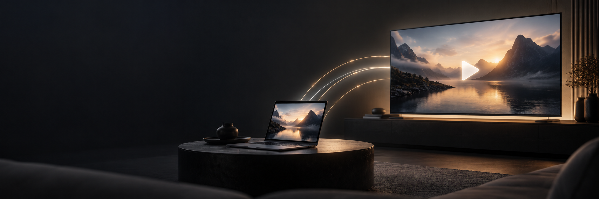

# stream. — Portable Windows Player

**Kleiner Player. Großes Kino.** Native Windows-App mit Google-Cast-Symbol für Google TV und Chromecast. Eigene Qt-Fenster und native Videowiedergabe: kein Browser, keine WebView und keine Webapp.

## Download & Start

1. Unter [Releases](https://github.com/Kiragroh/stream-player/releases/latest) die Datei **Stream-1.1.0-Windows-x64-portable.zip** herunterladen.
2. Die ZIP vollständig in einen beschreibbaren Ordner entpacken.
3. **Stream.exe** im entpackten Ordner doppelt anklicken.

Keine Installation, keine Administratorrechte, keine separate Python-, FFmpeg- oder Browser-Installation. Unterstützt Windows 10/11 x64. Den Ordner `_internal` bei der EXE belassen. Die App ist nicht digital signiert.

## Bedienung

- **Video öffnen**: ein oder mehrere Videos auswählen; Dateien auch direkt ins Fenster oder auf die EXE ziehen.
- **Cast-Symbol**: Google TV oder Chromecast im selben WLAN wählen. Alternativ die lokale TV-IP eingeben.
- Play/Pause, Spulen, ±10 Sekunden, Lautstärke, Stummschaltung, Wiedergabeliste und lokales Vollbild.
- **Hier weitersehen** holt die Wiedergabe an derselben Position vom TV auf den PC zurück.
- **Übertragung beenden** beendet den Cast. Beim Schließen der App endet auch die Übertragung. Zum Weitersehen auf dem TV die App minimieren.
- Leertaste: Play/Pause · Pfeile: ±10 Sekunden · M: stumm · F: Vollbild · Strg+O: öffnen.

## Formate

MP4, MKV, AVI, MOV, M4V, WebM, WMV, FLV, MPEG/MPG, TS, M2TS, MTS, OGV, VOB und 3GP.

Entscheidend sind auch die Codecs im Container. Kompatibles MP4/H.264/AAC spielt direkt; andere Dateien werden von FFmpeg vor der Wiedergabe vorbereitet. Passendes H.264 bis 1080p/30 fps bleibt unverändert. Andere Videospuren werden nach H.264 bis 1080p/30 fps, Audio bei Bedarf nach AAC Stereo umgewandelt. Die erste Video- und erste Audiospur werden verwendet.

Die Vorbereitung kann bei langen Filmen dauern und zusätzlichen Speicher brauchen. Erst nach Abschluss startet das Video, damit Dauer und Spulen zuverlässig funktionieren. Keine Garantie für jede Codec-Kombination. DRM, Untertitel, DVD-Menüs, mehrere auswählbare Tonspuren und HDR-Tonemapping sind nicht enthalten. Geschwindigkeit und Vollbild gelten für die lokale Wiedergabe.

## Portable & lokal

Cache und App-Daten liegen im Ordner **data neben Stream.exe**. Der App-Ordner kann verschoben werden; Originalvideos werden nicht kopiert oder verändert. Die Wiedergabeliste gilt für die laufende Sitzung. Um den Cache zu leeren, die App schließen und den Ordner `data/cache` löschen. Originale bleiben erhalten.

Für Cast betreibt die App ausschließlich einen lokalen Medien-Endpunkt auf einem freien Port. Dieser liefert nur das ausgewählte Video über eine zufällige Sitzungs-URL aus. Es gibt keine Website und keine Bedien-API. Keine Cloud, keine Telemetrie, keine Film-Uploads auf GitHub.

Bei Verbindungsproblemen: TV einschalten, gleiches WLAN verwenden, Gastnetz/VPN prüfen und gegebenenfalls Stream in der Windows-Firewall für das private Netzwerk erlauben. PC und App müssen während des Castens laufen.

## Entwicklung & portablen Build erstellen

```powershell
py -3 -m venv .venv
.\.venv\Scripts\python.exe -m pip install -r requirements-dev.txt
.\.venv\Scripts\python.exe -m stream_player
.\.venv\Scripts\python.exe -m pytest -q
.\.venv\Scripts\python.exe scripts/build_portable.py
```

Der Build erzeugt `dist/Stream/Stream.exe`, eine portable ZIP und `SHA256SUMS.txt`. PyInstaller bündelt Python, die benötigten nativen Qt-Bibliotheken, Multimedia-Plugins und FFmpeg. QtWebEngine und die frühere Browser-Oberfläche sind nicht Teil des Builds. `Start Stream.cmd` ist nur für Entwicklung aus dem Quellcode gedacht; für die fertige App die EXE aus dem Release benutzen.

## Design & Komponenten

Der Banner wurde mit GPT Image generiert; [Prompt](docs/banner-prompt.md). [Drittanbieter-Hinweise](THIRD_PARTY_NOTICES.md) und Lizenztexte liegen auch im Download. Stream ist unabhängig von Google.

- [Google Cast: unterstützte Medien](https://developers.google.com/cast/docs/media)
- [PyChromecast](https://github.com/home-assistant-libs/pychromecast)
- [Qt for Python](https://doc.qt.io/qtforpython-6/)
- [FFmpeg](https://ffmpeg.org/)
